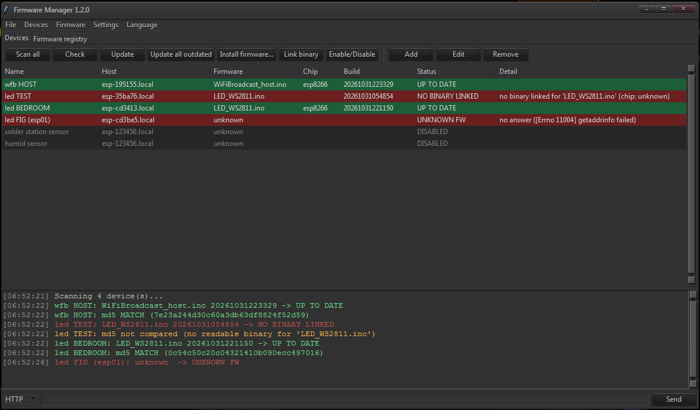
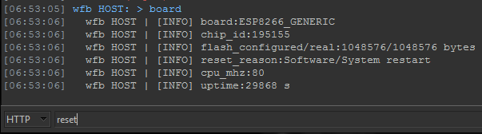

# fw-manager

A small desktop tool (Python + Tk) to keep the firmware of your network devices up to date.

It reads what firmware each device is running over HTTP, compares it with the binaries you have built, and uploads the new one with a command you define. It works with any device that reports its firmware over HTTP and accepts an upload command. ESP8266, ESP32 and curl examples are included.



Send messages to a device over HTTP or TCP and get the response in the log:



## Features

- **Device list** with name, host, firmware id, chip, build, status and detail.
- **Scan all / Check**: reads the version endpoint of each device and shows a status per row:
  `UP TO DATE`, `UPDATE AVAILABLE`, `NEWER ON DEVICE`, `NO BINARY LINKED`, `UNKNOWN FW`.
- **Firmware registry**: one entry per firmware id and chip, with the binary file, an upload command and an optional manual build number. An entry with an empty chip matches any chip; a chip-specific entry wins.
- **Update, Update all outdated, Install firmware, Link binary** per device.
- **MD5 check**: if the device reports an md5, it is compared with the linked binary and decides the status; otherwise build numbers decide.
- Send messages to devices over HTTP or TCP and get the response in the log.
- **Enable / Disable** devices; disabled ones are skipped by Scan all and Update all.
- **Customizable**: themes (Settings > Theme), column visibility (right-click a column header), window layout, and language (Language menu).

## Requirements

- Python 3.8 or newer
- tkinter
- For OTA uploads with the example commands: `espota.py` from the ESP8266 / ESP32 Arduino cores, or `curl`.

## Platform support

| Platform | Status |
| --- | --- |
| Windows | OK |
| Linux | Should be OK, not tested |
| Android | Limited: mDNS (`.local` host names) may not work if the OS does not support it, so use IP addresses; the UI is too big for the screen |

## Run

```
python fw_manager.py
```

On first start the program creates `fw_manager.properties` if it is missing.

## Files

| File | Purpose |
| --- | --- |
| `fw_manager.py` | Main program |
| `fw_manager_theme.py` | Themes and the theme editor |
| `fw_manager_lang.py` | Loads the language files |
| `lang/*.json` | Program text, one file per language (`en.json`, `ja.json`) |
| `theme/*.json` | One file per theme (`dark_os`, `light_os`, `dark_night`, `dark_neutral`, `dark_dracula`, `dark_amber`) |
| `fw_manager.properties` | Variables and upload commands |
| `fw_manager.json` | Your devices, firmware registry and UI settings |

Keep `lang/` and `theme/` next to the scripts; the program loads its text and themes from there.

## What your devices must report

Each device needs an HTTP endpoint (default path `/version`, set per device) that returns JSON like:

```json
{"id": "LED_WS2811.ino", "build": 20261029041512, "md5": "<32 hex chars>", "chip": "esp8266"}
```

`md5` and `chip` are optional. On ESP8266 / ESP32 the md5 comes from `ESP.getSketchMD5()`.

## Variables

`fw_manager.properties` holds your variables and upload commands:

```
# name=value       variable, use it as {name}
# cmd.<id>=...     upload command, selected by <id> in the Firmware tab
espota8266=%LOCALAPPDATA%\Arduino15\packages\esp8266\hardware\esp8266\*\tools\espota.py
cmd.espota8266=python "{espota8266}" -i {host} -p 8266 -f "{file}"
cmd.curl=curl -sS -F "file=@{file}" http://{host}:{port}/update
http_timeout=3.0
```

- Built-in placeholders: `{host}` `{port}` `{name}` `{id}` `{file}` `{build}` `{chip}`.
- Variables can use other variables and environment variables (`%NAME%`).
- A path with `*` uses the newest match.
- `http_timeout` is how many seconds to wait for a device to answer (read once at start).
- The shipped paths assume the Windows Arduino15 location. Change them for your system.

Open the file from the program with Settings > Open variables file.

## Build number of a binary

The first match wins:

1. the manual `build` field of the registry entry
2. a sidecar file `<binary>.json` containing `{"build": ...}`
3. a 14-digit timestamp (`YYYYMMDDHHMMSS`) in the file name
4. the file modification time, formatted as `YYYYMMDDHHMMSS`

## Themes

Pick a theme in Settings > Theme. It is used the next time the program starts.

| Theme | Look |
| --- | --- |
| `dark_os` | OS widgets, dark text and row colors |
| `light_os` | OS widgets, light row colors |
| `dark_night` | Neutral dark |
| `dark_neutral` | Soft grey dark |
| `dark_dracula` | Dracula palette |
| `dark_amber` | Amber on dark brown |

Settings > Theme > Edit theme... edits every color of a theme, with a live preview on the left. Typing a new theme file name saves a copy. An empty color means "not set": the system draws that part itself, which is how the `_os` themes keep the OS look.

A theme file is `theme/<code>.json` (letters, digits, `_` and `-`):

```json
{
  "theme_name": "Dark OS",
  "ttk_theme": "",
  "palette": {"bg": "", "surface": "", "field": "", "fg": "", "select_bg": "", "...": ""},
  "log": {"err": "#c75450", "warn": "#ffb454", "ok": "#6fdc8c", "info": "#6cb6ff", "dim": "#8b949e"},
  "status": {"up_to_date": "#1b5e38", "update_available": "#6b5a12", "...": ""},
  "table": {"text": "#d4d4d4", "disabled_text": "#808080"},
  "selection": {"text": "#ffffff", "background": "#1f6feb"}
}
```

`ttk_theme` is the base ttk theme (empty = system). The color descriptions come from `lang/*.json`.

## Adding a language

Copy `lang/en.json` to `lang/<code>.json`, set `"language.name"` and translate the values (keep the `{placeholders}`). It then appears in the Language menu. Missing entries fall back to English.

## License

MIT, see [LICENSE](LICENSE).
